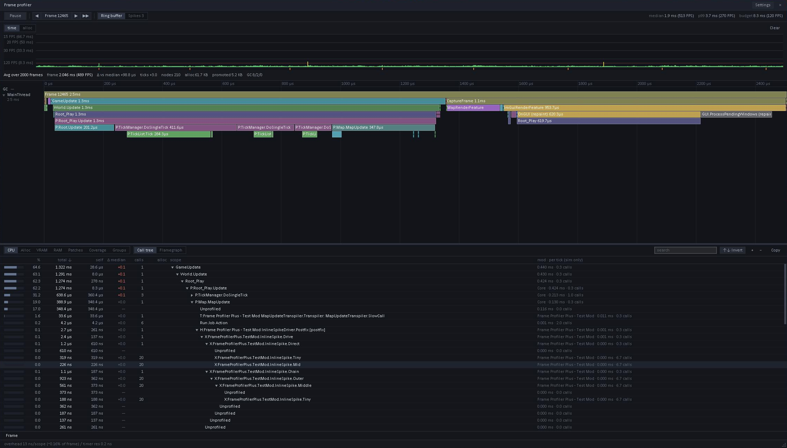

# Frame Profiler Plus

Frame Profiler Plus extends the RimWorld 1.7 Frame Profiler with Harmony patch timing, wider method coverage and per-tick groups. It works inside the vanilla window. There is no second profiler.

Open the profiler with Dev mode, Debug actions, General, Frame profiler.

Every feature is off by default. Each one needs a game restart after you change it.

Full documentation is on the [wiki](https://github.com/keyz182/FrameProfilerPlus/wiki). It has a tutorial, how-to guides, reference pages and explanations.

## What you get

| Feature | What it shows | Where |
|---|---|---|
| Harmony attribution | The time of each Harmony prefix, postfix and finalizer, and the mod that owns it | `H:` and `P:` rows in the CPU tab, and the Patches tab |
| Transpiler attribution | The time of each call that a transpiler added or retargeted | `T:` rows, and the Patches tab |
| Extended coverage | The time of methods the vanilla profiler skips: constructors, lambdas, iterators and small methods | `X:` rows, and the Coverage tab |
| Per-tick groups | Tick time grouped by ThingDef, job driver type and comp type, with the worst frame of each group | The Groups tab |

The CPU tab also gets a Detail column. It shows the owner mod of our scopes, and the time and calls per tick for the selected frames. Only simulation code has a meaningful per-tick figure.



## Requirements

- RimWorld 1.7.
- The Harmony mod (`brrainz.harmony`). Load Frame Profiler Plus directly after it.

## Settings

Open Options, Mod settings, Frame Profiler Plus.

| Setting | What it does | Cost |
|---|---|---|
| Harmony attribution | Times each patch call, and each patched method as a whole | About 2 % of idle frame time on a 94-mod list, within measurement noise |
| Time calls added by transpilers | Times calls that foreign transpilers added or retargeted. Needs Harmony attribution | Not measured on its own. A 449-mod list booted in 95 s with both settings on |
| Extended method coverage | Turns on the Coverage tab and its row-menu actions | None until you press Apply |
| Apply coverage targets at startup | Times the saved targets when the game loads | About 0.7 ms per method at boot |
| Most methods timed at once | Upper limit for one Apply | The profiler buffer overflows when too many scopes are live |
| Per-tick grouping | Times each thing's tick while the profiler captures | About 51 ns per timed call. This is a microbenchmark, not a full-game figure |
| Time job drivers, Time comps | Add job driver and comp groups to the Groups tab | Same as above |
| Label ceiling | Stops new profiler labels at this count | The profiler allows 65,535 labels for all mods together |

## How to use it

1. Open the profiler window. It captures while it is open. Let the game run unpaused.
2. Open the Patches tab to see each mod's patch time, with its patches below it.
3. Open the Coverage tab to time more methods. Write one target per line, for example `MyMod!MyMod.Foo::Bar`. Use `-` at the start of a line to exclude. Press Preview, then Apply.
4. Open the Groups tab to see tick time per group. Right-click a group row, then choose "Jump to worst frame". The profiler selects that frame.
5. Right-click a row in the CPU tab to add coverage targets for that method, its lambdas, or the methods it calls.

## How to read the numbers

- **Self time.** The Groups tab shows the time spent in the group's own code. Calls nested inside it, of the same kind, are not counted.
- **Groups overlap.** A pawn's tick contains its job driver and its comps. Do not add the roots together.
- **Per tick.** A group's time is divided by the game ticks of the selected frames. RimWorld 1.7 runs some tick work every few ticks, so the worst frame can be much higher than the mean.
- **Muted rows.** The vanilla profiler mutes a scope that is cheap and runs often. A muted scope shows 0 and the word "muted". Its mod total is too low.
- **Transpilers.** Only calls that a transpiler added or retargeted get a `T:` row. IL that a transpiler adds inline is not timed.

## Limits

- A method that you time with Extended coverage stays detoured until the game restarts. Pressing Clear stops the timing. It does not remove the detour. Vanilla timing on that method records nothing after the detour.
- The JIT can inline small methods into their callers. Apply also recompiles the callers of each target, up to 64 per target. A method can still show "never seen: inlined, or not called".
- Methods that another mod patches get a `P:` scope instead of an `X:` scope.
- Methods that vanilla already times are skipped.
- The Groups tab keeps about 1,200 frames. An older frame shows "That frame has left the profiler history".
- The Human calls per tick can read higher than the number of colonists. The cause is not confirmed. It is probably pawns that are not on the map.
- The hooks use Harmony 3.0.0-rc.3 internals. If a later Harmony changes them, the feature turns itself off and writes a warning to the log.

## Development

Build the mod:

```
cd Source
dotnet build -c Release
```

Run the tests:

```
cd Tests
dotnet test
```

`dotnet test` builds a Debug copy into `1.7/Assemblies`. Run the Release build again before you commit the DLL.

`TestMod` is a development mod. It has known patches, a transpiler and a workload for in-game checks.

Always start the game for tests with `-savedatafolder=<a scratch folder>`. RimWorld 1.7 resets `ModsConfig.xml`, so do not point it at your real save-data folder.

## Releasing

Releases use [cocogitto](https://docs.cocogitto.io/) (`cog`). Commit messages follow the conventional commit format, and `cog` picks the next version from them.

You need `cog` (tested with 7.0.0), the .NET SDK and the game's DLLs. The build needs the game's DLLs, so a CI runner cannot build the mod. `cog` builds the DLL on your machine and commits it.

Run the release in your own terminal. `cog` signs its commit and tag with your git signing key.

1. Check out `main` with a clean working tree. Untracked files count as changes.
2. For the first release, run `cog bump --version 1.0.0`. For later releases, run `cog bump --auto`.
3. `cog` writes `CHANGELOG.md`. It then runs these checks. Any failure stops the release before the commit.
   1. The working tree is clean.
   2. The tests pass.
   3. A Release build runs, and the version is stamped into the DLL.
   4. The version is written to `modVersion` in `About/About.xml`.
   5. `scripts/verify-release.sh` checks that the DLL to ship is identical to the Release build output, and that `modVersion` and `LICENSE` are right.
4. `cog` makes one commit, `chore(version): vX.Y.Z`, with the DLL, `About.xml` and `CHANGELOG.md`. It tags that commit.
5. Run `git show --stat HEAD`. It must list only those three files.
6. Optional: run `sh scripts/package.sh X.Y.Z`, then `sh scripts/check-zip.sh dist/FrameProfilerPlus-vX.Y.Z.zip`. This builds the zip that CI will publish.
7. Run `git push --follow-tags`.

The Release workflow starts when the tag arrives. It checks the tag, the version in `About.xml`, the commit subject and the zip contents. It then creates a GitHub release with the zip and the changelog section. It never builds the mod.

The zip holds `About/About.xml`, `1.7/Assemblies/FrameProfilerPlus.dll` and `LICENSE`.

### If something fails

- **A check fails during `cog bump`.** `cog` stashes the changes that the checks made and names the stash in its message. Fix the cause, then run `cog bump` again.
- **The Release workflow fails after the push.** The tag stays on GitHub with no release. Fix the cause. Deleting and pushing the tag again is the owner's decision.

### What is not checked

- The assembly version in the DLL. `cog` stamps it, but nothing reads it back.
- `scripts/test-verify-release.sh` proves that the release check rejects a Debug DLL. Run it after you change `scripts/verify-release.sh`.

## Licence

MIT. See [LICENSE](LICENSE). The code is written from scratch.
